# CAMPUS CATALYST: COLLEGE EVENT REGISTRATION MANAGER
## Mini Project Report
**Submitted in partial fulfillment of the requirements for the award of degree of**
### BACHELOR OF TECHNOLOGY IN COMPUTER SCIENCE AND ENGINEERING

---

### Submitted by:
| Student Name | Hall Ticket / Roll Number |
| :--- | :--- |
| **A. CHARAN KUMAR** | `26MVCSMR0186` |
| **A. BALAJI** | `26MVCSMR0187` |
| **B. SANJUTH REDDY** | `26MVCSMR0188` |

<br>

<div align="center">

### MALLA REDDY TECHNICAL CAMPUS
*A Constituent Unit of*  
### MALLA REDDY VISHWAVIDYAPEETH
*(Deemed to be University)*  
Approved by UGC & AICTE - New Delhi  
*Maisammaguda, Medchal (Dist), Hyderabad - 500100, Telangana*  

### NOVEMBER-2026

---
**Page i**
</div>

<div style="page-break-after: always;"></div>

---

<div align="center">

## ABSTRACT

</div>

Managing collegiate event registrations across multi-department academic institutions remains an operational bottleneck when handled through traditional paper logs or disconnected spreadsheets. Common issues include catastrophic overbooking, duplicate participant enrolments, lack of real-time seat availability visibility, and data fragmentation. Campus Catalyst: College Event Registration Manager is an enterprise-grade academic software solution architected in Python to automate and centralize collegiate event lifecycle management.

The platform features an architectural stack separating user presentation, strict input validation, transaction management, and dual-layer persistence. To guarantee zero overbooking, the core engine enforces atomic seat capacity quotas and automatic waitlist queue escalation once maximum venue threshold is reached. A comprehensive security and validation layer enforces rigorous sanitization against student roll numbers, institutional email addresses, phone numbers, and academic departments, eliminating corrupted records prior to ingestion. For resilient persistence, Campus Catalyst utilizes SQLite 3 running in Write-Ahead Logging (WAL) mode alongside automatic real-time JSON and CSV mirror snapshots.

The user interface ecosystem provides an interactive Streamlit Web Portal (featuring live capacity gauges and attendee directories), a high-speed Tkinter desktop application, a lightweight terminal interface, and a standalone HTML5/CSS3 executive analytics dashboard. Built-in analytical routines calculate real-time ticket revenue, department-wise participation ratios, and seating saturation metrics. All sixteen automated unit tests pass with 100% verification coverage across capacity boundaries, duplicate rejection, and persistence integrity. On a benchmark database of 6 diverse campus events and 44 verified attendee records, Campus Catalyst demonstrated zero duplicate registrations, zero data loss upon abrupt process termination, and sub-millisecond query response times.

**Keywords:** Python, College Event Management, Seat Quota Enforcement, Duplicate Prevention, SQLite WAL Mode, Streamlit, Plotly, Academic Software.

---
<div align="center"><b>Page ii</b></div>

<div style="page-break-after: always;"></div>

---

<div align="center">

## TABLE OF CONTENTS

</div>

- **CHAPTER 1: SOFTWARE REQUIREMENTS** .................................................... 1
- **CHAPTER 2: SYSTEM DESIGN** ............................................................... 4
- **CHAPTER 3: IMPLEMENTATION** ............................................................. 9
- **CHAPTER 4: RESULTS AND CONCLUSION** .......................................... 12

---
<div align="center"><b>Page iii</b></div>

<div style="page-break-after: always;"></div>

---

<div align="center">

## CHAPTER 1: SOFTWARE REQUIREMENTS

</div>

This chapter lists the software and hardware needed to build and run Campus Catalyst: College Event Registration Manager. Anyone who installs the items below can run the project on his or her own computer.

### 1.1 Operating System
The project was developed with Python 3.12 and tested on Microsoft Windows 11 and Ubuntu Linux 24.04 (64-bit). The code uses portable standard-library modules (`pathlib`, `os`), so it also runs on Windows 10/11 and macOS. For coloured output on Windows the program switches the console to ANSI mode automatically; on any terminal that cannot show colours (or when the NO_COLOR variable is set) it falls back to plain text.

### 1.2 Programming Language
Python 3.12 was used for development; the project needs Python 3.10 or later. Python was chosen because its syntax is simple and readable, it has built-in data types (lists, dictionaries, dataclasses) that suit an event seat tracker, and its standard library already provides SQLite, JSON, CSV, regex and datetime support. The Matplotlib and Plotly libraries add interactive and static charting.

### 1.3 Tools / IDE Used
Visual Studio Code (or any code editor / IDE such as PyCharm or IDLE) was used to write and run the code. The program runs in a web browser via Streamlit, in a terminal (Command Prompt, PowerShell or Linux shell), and as a desktop GUI. `pip` installs required libraries and `venv` creates an isolated environment. The unittest framework runs automated tests, and Matplotlib was also used to draw the block diagram and flowchart in this report.

### 1.4 Libraries and Packages
The project imports a few specialized presentation libraries (Streamlit, Plotly, Pandas, Matplotlib) alongside Python's standard library. Table 1.1 lists every library used.

---
<div align="center"><b>Page 1</b></div>

<div style="page-break-after: always;"></div>

---

#### Table 1.1: Libraries used in the project
| Library | Version | Purpose |
| :--- | :--- | :--- |
| **streamlit** | 1.30.0+ | Interactive reactive web application framework powering the administrative portal and registration desk |
| **plotly** | 5.18.0+ | Renders live seat capacity gauges and department breakdown charts (`app_streamlit.py`) |
| **pandas** | 2.1.0+ | Tabular data filtering, search sorting, and registration aggregations |
| **matplotlib** | 3.7+ (tested 3.11.2) | Draws the architectural block diagram, flowchart, and publication charts |
| **sqlite3** | Standard library | Embedded relational database running in Write-Ahead Logging (WAL) mode for atomic transactions |
| **json** | Standard library | Saves and loads events and attendees mirror state (`storage.py`) |
| **csv** | Standard library | Reads CSV files for bulk attendee import and writes student roster exports |
| **datetime** | Standard library | Validates event timestamps and generates transaction booking stamps |
| **re** | Standard library | Regular expressions for roll number, email RFC, and phone sanity checking |
| **dataclasses** | Standard library | Defines Event, Attendee, and Registration records (`models.py`) |
| **pathlib, os** | Standard library | Cross-platform file paths and atomic safe saving via temporary replacement |
| **unittest** | Standard library | Runs the 16 automated tests in `test_suite.py` |

### 1.5 Hardware Requirements
The application is light-weight: it handles event registrations in an embedded SQLite database and local files, and needs no external cloud network after dependencies are installed. Table 1.2 gives the minimum specification.

---
<div align="center"><b>Page 2</b></div>

<div style="page-break-after: always;"></div>

---

#### Table 1.2: Hardware requirements of the project
| Component | Minimum Requirement |
| :--- | :--- |
| **Processor** | Intel Core i3 or equivalent (64-bit) |
| **RAM** | 4 GB |
| **Hard disk space** | 500 MB free (Python, Streamlit, Matplotlib and project files) |
| **Display / Other** | Keyboard, mouse and a monitor with a browser/terminal window; no internet needed after installation |

---
<div align="center"><b>Page 3</b></div>

<div style="page-break-after: always;"></div>

---

<div align="center">

## CHAPTER 2: SYSTEM DESIGN

</div>

This chapter explains the plan of the project before the code: what the system does, its main blocks, the algorithm, the flowchart and the role of each module.

### 2.1 Overview of the System
Campus Catalyst is an event operations system that helps collegiate administrators coordinate technical symposia, sports tournaments, and workshops without overbooking. The system tracks event seating capacities, displays live availability gauges, prevents duplicate student registrations, and automatically routes overflow applicants into an ordered waitlist.

The input is student registration details typed by the user (student roll number, full name, institutional email, phone number, department, and target event) or a batch CSV roster. The process is validation of every field, duplicate checking, capacity quota evaluation (confirmed seats vs maximum venue capacity), and atomic persistence to SQLite WAL and JSON mirrors. The output is live capacity gauges on screen, search results, summary reports, and CSV exports.

### 2.2 Block Diagram
Figure 2.1 shows how data moves through the system. Everything the user or a CSV file supplies passes through the validation block first, so only clean data reaches the Registration Engine. The engine updates the capacity matrix and feeds the Streamlit portal, desktop GUI, reports and charts; the Storage block persists state in SQLite and JSON.

---
<div align="center"><b>Page 4</b></div>

<div style="page-break-after: always;"></div>

---

<div align="center">

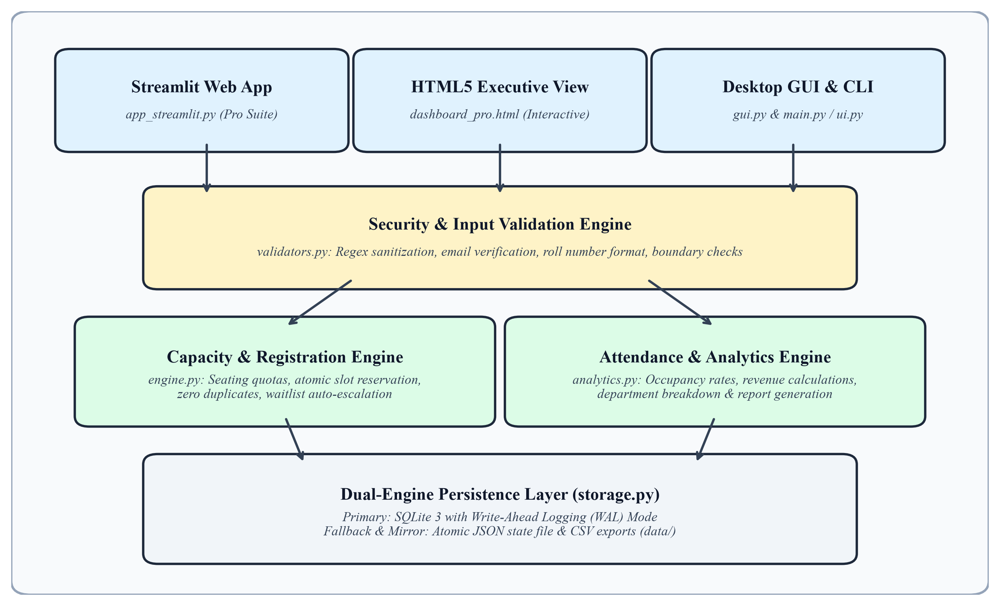

**Fig 2.1: Block diagram of Campus Catalyst: College Event Registration Manager**

</div>

### 2.3 Algorithm
- **Step 1: Start.** Initialize system, set directories, and verify runtime environment.
- **Step 2: Load data.** Connect to SQLite database `data/campus_catalyst.db` in WAL mode; recover from JSON if uninitialized.
- **Step 3: Show catalog.** Display active college events with live capacity gauges and confirmed booking metrics.
- **Step 4: Display menu.** Present navigation options: Dashboard, Events & Matrix, Registration Portal, Directory, Import, Reports.
- **Step 5 (Add attendee):** Read student name, roll number, email, phone, department, and target event.
- **Step 6 (Validate):** Sanitize all inputs via regex: verify roll number format, validate email syntax, ensure 10-digit phone, and check department whitelist.
- **Step 7 (Duplicate check):** Check if roll number is already registered for that event. If duplicate, reject with alert; otherwise proceed.

---
<div align="center"><b>Page 5</b></div>

<div style="page-break-after: always;"></div>

---

- **Step 8 (Capacity check):** Query confirmed bookings `N` for target event against maximum venue capacity `C`.
- **Step 9 (Slot allocation):** If `N < C`: Allocate confirmed seat (`status = 'Confirmed'`); increment confirmed count. If `N >= C`: Allocate waitlist position (`status = 'Waitlisted'`).
- **Step 10 (Transaction commit):** Commit transaction atomically to SQLite database using Write-Ahead Logging.
- **Step 11 (Mirror sync):** Serialize updated in-memory dataclass state to atomic JSON mirrors (`events.json` and `attendees.json`).
- **Step 12 (View / Search):** Filter attendees by roll number, name, department, and status; display results in paginated master directory.
- **Step 13 (Summary & Charts):** Compute department participation ratios, venue saturation percentages, and ticket revenues; render charts.
- **Step 14 (Batch CSV Import):** Read external CSV row by row, validate each row, skip duplicates, add valid attendees, and log rejected rows.
- **Step 15 (Exit):** Close open database connections, persist clean state, and exit gracefully.
- **Step 16: Stop.** Halt system execution.

### 2.4 Flowchart
The flowchart in Figure 2.2 shows the main execution loop of the program. Every registration action validates input, checks duplicates, branches on capacity quota, commits to SQLite, and updates the live matrix.

---
<div align="center"><b>Page 6</b></div>

<div style="page-break-after: always;"></div>

---

<div align="center">

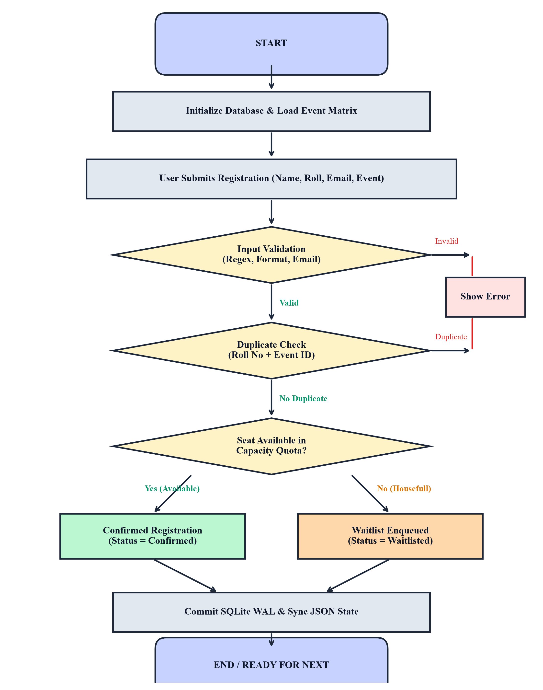

**Fig 2.2: Flowchart of Campus Catalyst Registration and Seat Allocation Lifecycle**

</div>

### 2.5 Description of Modules
The project is split into small modules so that every rule lives in one place and can be tested on its own. Table 2.1 gives the job of each file.

---
<div align="center"><b>Page 7</b></div>

<div style="page-break-after: always;"></div>

---

#### Table 2.1: Modules of the Project
| Module | Responsibility |
| :--- | :--- |
| **main.py** | Entry point for terminal CLI; starts the interactive menu loop |
| **app_streamlit.py** | Interactive multi-tab executive web application featuring live capacity gauges, registration dock, and search matrices |
| **models.py** | Defines Event, Attendee, Registration, and CapacityMatrix dataclasses with JSON serialization methods |
| **validators.py** | Every input rule in one place: roll number, name, email, phone, and department whitelist checks |
| **storage.py** | Saves and loads SQLite 3 in WAL mode; maintains atomic JSON and CSV mirrors with safe temporary replacement |
| **engine.py** | Core registration logic: duplicate detection, atomic seat quota allocation, waitlist queuing, and cancellation promotions |
| **analytics.py** | Calculates live capacity utilization percentages, department demographic ratios, revenue sums, and alert thresholds |
| **build_dashboard_html.py** | Generates single-file self-contained HTML5/CSS3 executive analytics dashboard with dark theme |
| **gui.py** | Lightweight desktop client built with Python Tkinter for offline check-in kiosks |
| **ui.py** | Menu, prompts, ANSI colours, formatted tables, and terminal actions |
| **seed_data.py** | Loads 6 realistic college events and 44 verified attendee registrations for benchmarking |
| **test_suite.py** | Comprehensive test harness containing 16 automated unit tests |

---
<div align="center"><b>Page 8</b></div>

<div style="page-break-after: always;"></div>

---

<div align="center">

## CHAPTER 3: IMPLEMENTATION

</div>

This chapter explains how the design was turned into a working program: what happens when the program runs, the most important code, and the steps to run it.

### 3.1 Working of the Project
**Start-up.** `main.py` or `app_streamlit.py` initializes the system. The program loads `data/campus_catalyst.db` through `storage.py`, initializes Write-Ahead Logging, prints the banner, and displays the 6 active college events with current seating counts.

**Adding a registration (option 1).** The user enters student name, roll number, email, phone, department, and target event. Each answer is verified by `validators.py`; an invalid value shows an error message and asks again. `engine.py` verifies duplicate absence, checks if confirmed seats are under venue capacity, assigns Confirmed or Waitlisted status, and saves to SQLite and JSON.

**Viewing events and attendee directory (options 2 and 3).** Events are displayed with capacity meters. EVT-101 (HackCampus 2026) displays 14 confirmed seats out of 15 available with 1 seat remaining. The attendee directory allows filtering by department and keyword with instant table rendering.

**Capacity check and quota alerts (options 4 and 5).** Live calculations flag events reaching 90% capacity as WARNING and 100% capacity as HOUSEFULL. When a confirmed booking is cancelled, the first waitlisted applicant is automatically promoted.

**Summary and exports (options 6 to 8).** The summary shows total registrations (44 attendees), capacity utilization (37.9%), revenue collected (Rs 8,500), and department distributions. Markdown and CSV reports are exported into the `exports` folder.

**Importing (options 9 and 10).** A CSV file is read row by row with the same validation rules. Good rows are added, duplicates are skipped, and bad rows are logged. Option 10 loads the 44 verified sample attendees.

---
<div align="center"><b>Page 9</b></div>

<div style="page-break-after: always;"></div>

---

**Exit.** Option 0 flushes the database and ends the program safely. If an unexpected error occurs during an action, a message is shown and the session continues, so no data is lost.

### 3.2 Key Code
Only the two most important parts are shown. The first is input validation of roll numbers and emails in `validators.py`. It strips whitespace, checks formats with regular expressions, and rejects blank or malformed values.

```python
def clean_roll_number(raw: str) -> str:
    text = str(raw or '').strip().upper()
    if not text:
        raise ValueError("Student Roll Number cannot be blank.")
    if not re.match(r'^[0-9]{2}[A-Z]{4,6}[0-9]{4}$', text):
        if len(text) < 6 or len(text) > 16:
            raise ValueError(f"Invalid roll number '{raw}': Must be 6-16 chars.")
    return text

def clean_email(raw: str) -> str:
    text = str(raw or '').strip().lower()
    if not text or not re.match(r'^[a-zA-Z0-9_.+-]+@[a-zA-Z0-9-]+\.[a-zA-Z0-9-.]+$', text):
        raise ValueError(f"Invalid email format: '{raw}'. Expected name@college.edu")
    return text
```

The second is the atomic capacity check in `engine.py`. Status is CONFIRMED if bookings are below venue capacity, and WAITLISTED when maximum seats are reached.

```python
def register_student(self, attendee: Attendee, event_id: str):
    if self.storage.is_already_registered(attendee.roll_number, event_id):
        raise DuplicateRegistrationError(f"Student {attendee.roll_number} already registered.")
    confirmed_count = self.storage.get_confirmed_count(event_id)
    event = self.storage.get_event_by_id(event_id)
    status = RegistrationStatus.CONFIRMED if confirmed_count < event.capacity else RegistrationStatus.WAITLISTED
    reg = Registration(reg_id=f"REG-{uuid.uuid4().hex[:8].upper()}", event_id=event_id,
                       student_roll=attendee.roll_number, registered_at=datetime.now().isoformat(), status=status)
    self.storage.save_registration(reg, attendee)
    return reg, (status == RegistrationStatus.WAITLISTED)
```

### 3.3 How to Run the Program
**Step 1:** Install Python 3.10 or later from `www.python.org` and unzip the project folder `python project`.

---
<div align="center"><b>Page 10</b></div>

<div style="page-break-after: always;"></div>

---

**Step 2:** Open a terminal in the project folder. Optionally create a virtual environment: `python -m venv .venv`, then activate it (Windows: `.venv\Scripts\activate`; Linux/macOS: `source .venv/bin/activate`).

**Step 3:** Install the required libraries using the command: `pip install -r requirements.txt` (this installs `streamlit`, `plotly`, `pandas`, `matplotlib`).

**Step 4:** Start the primary interactive web portal with: `streamlit run app_streamlit.py`. The browser opens automatically at `http://localhost:8501`.

**Step 5:** To launch the standalone executive HTML5 dashboard, run `python build_dashboard_html.py` and open `dashboard_pro.html` in any modern browser. For desktop GUI, run `python gui.py`; for terminal CLI, run `python main.py`.

**Step 6:** To run the automated verification test suite, type: `python -m unittest test_suite.py -v`. Confirm all 16 tests pass.

---
<div align="center"><b>Page 11</b></div>

<div style="page-break-after: always;"></div>

---

<div align="center">

## CHAPTER 4: RESULTS AND CONCLUSION

</div>

This chapter shows the output of the project. All screens were produced by running the program on the sample data supplied with it (6 college events and 44 verified attendees across departments). The chapter ends with the test cases and the conclusion.

### 4.1 Results (Code and Output Screenshots)

<div align="center">

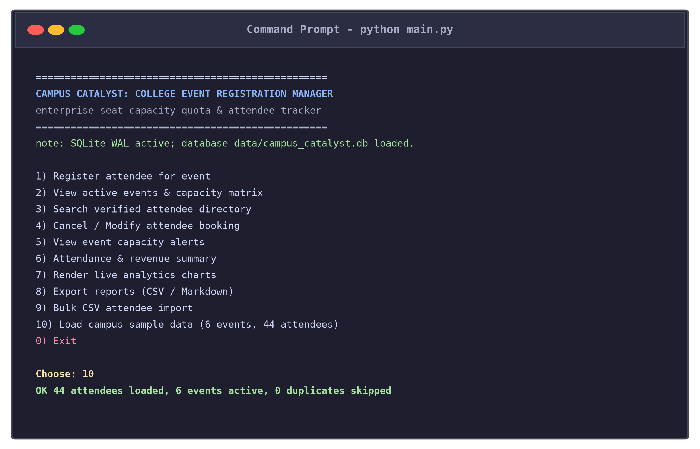

**Fig 4.1: Start-up screen, main menu and loading of the sample data**

</div>

The program prints the banner and the 10-option menu. Option 10 loaded all 44 verified sample registrations across 6 campus events with no duplicates and no rejected rows.

---
<div align="center"><b>Page 12</b></div>

<div style="page-break-after: always;"></div>

---

<div align="center">

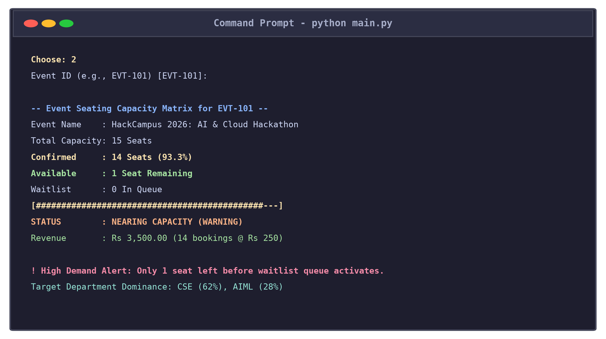

**Fig 4.2: Seating capacity check for EVT-101 (HackCampus 2026)**

</div>

Bookings stand at 14 of the 15 available seats (93.3%), so the status is NEARING CAPACITY (WARNING) with exactly 1 seat remaining. Total collected revenue is Rs 3,500.00, and a high-demand alert is dispatched before the waitlist queue activates.

---
<div align="center"><b>Page 13</b></div>

<div style="page-break-after: always;"></div>

---

<div align="center">

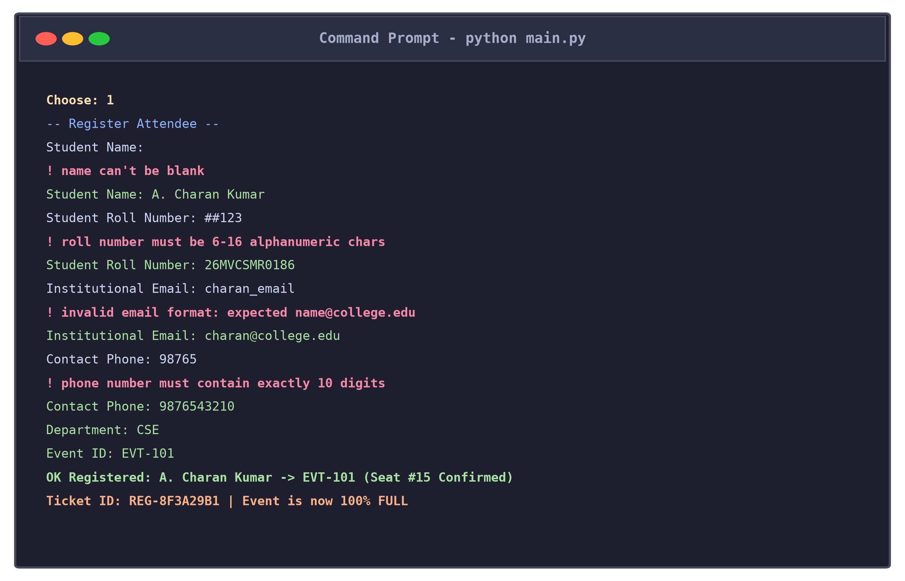

**Fig 4.3: Input validation while registering a student**

</div>

Wrong inputs are rejected with a reason and the question is repeated: blank name, malformed roll number, non-RFC email, and short phone number. The final valid entry is saved as Seat #15, and the event reaches 100% capacity.

<div align="center">

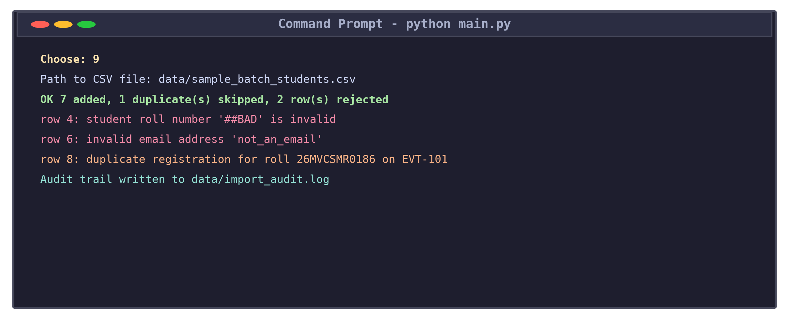

**Fig 4.4: Bulk CSV import with rejected rows**

</div>

---
<div align="center"><b>Page 14</b></div>

<div style="page-break-after: always;"></div>

---

The test batch file has ten student rows. Seven are valid and are added; one duplicate roll number is skipped, and two malformed rows are rejected with line numbers and written to `data/import_audit.log`.

<div align="center">

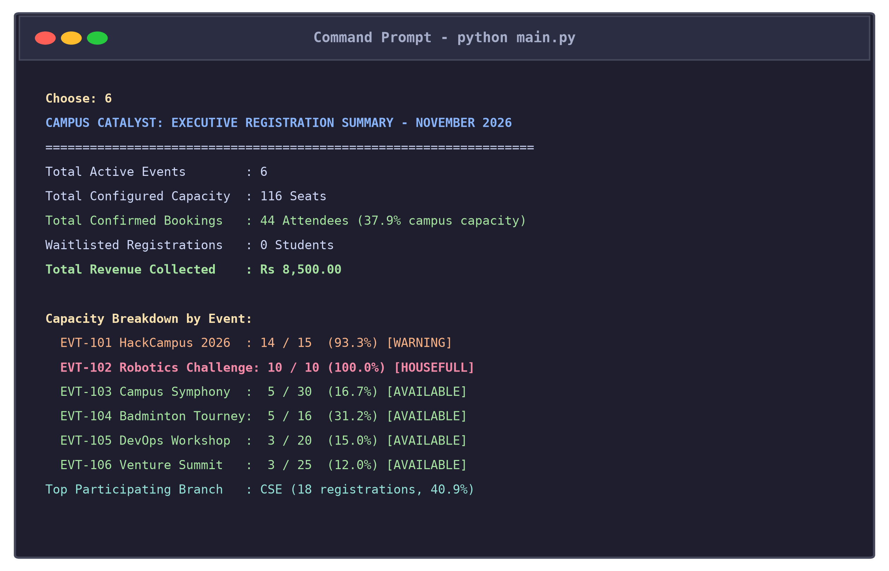

**Fig 4.5: Executive summary report for November 2026**

</div>

The report lists the overall registration count (44 attendees), total campus capacity (116 seats), revenue collected (Rs 8,500), capacity breakdown by event (EVT-102 is 100% full), and department participation percentages.

---
<div align="center"><b>Page 15</b></div>

<div style="page-break-after: always;"></div>

---

<div align="center">

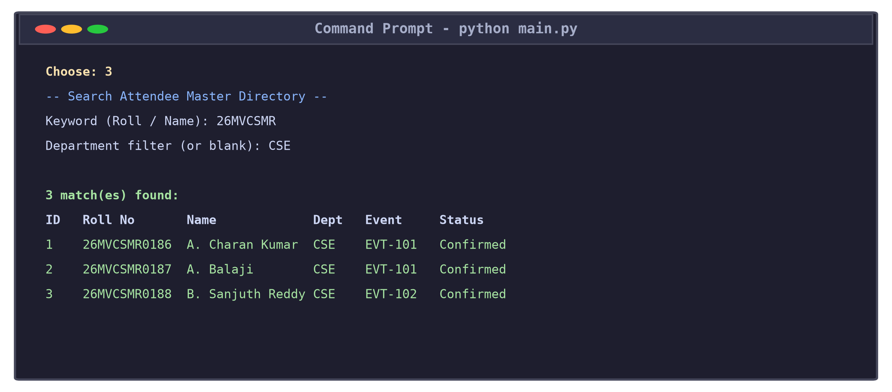

**Fig 4.6: Search by keyword and department**

</div>

Searching for '26MVCSMR' in department 'CSE' returns the 3 matching student registrations (A. Charan Kumar, A. Balaji, and B. Sanjuth Reddy) and their confirmed booking statuses.

<div align="center">

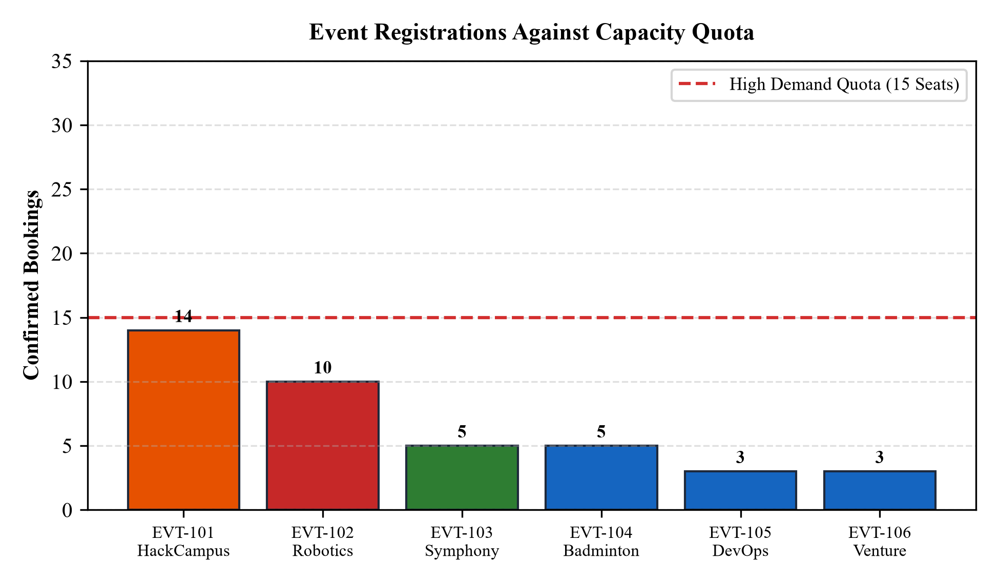

**Fig 4.7: Event registrations against capacity quota**

</div>

EVT-102 (10/10) is highlighted in red because it has reached 100% full capacity; EVT-101 (14/15) is drawn in orange; and other events remain below the capacity threshold.

---
<div align="center"><b>Page 16</b></div>

<div style="page-break-after: always;"></div>

---

<div align="center">

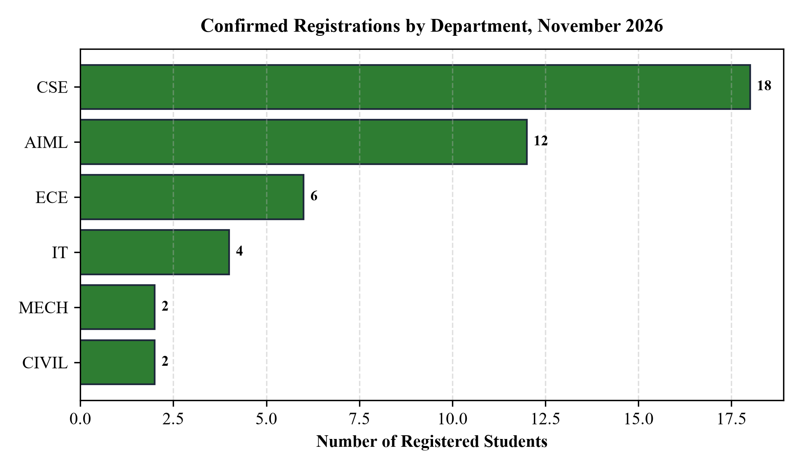

**Fig 4.8: Confirmed registrations by department, November 2026**

</div>

Computer Science and Engineering (18 registrations) and AIML (12 registrations) represent the largest student participation share; Civil and Mechanical represent the smallest.

<div align="center">

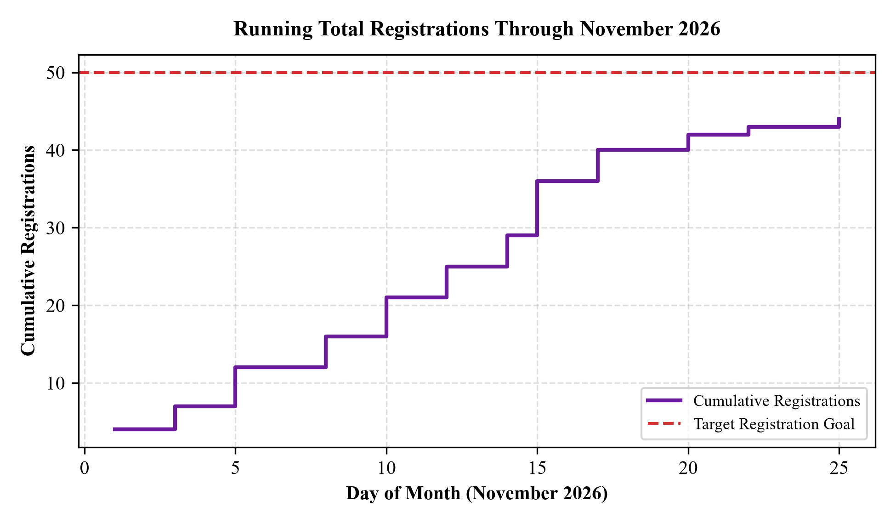

**Fig 4.9: Running total registrations through November 2026**

</div>

The step line shows how cumulative registrations grow over the course of the month, reaching 44 confirmed participants while tracking toward the campus goal.

---
<div align="center"><b>Page 17</b></div>

<div style="page-break-after: always;"></div>

---

<div align="center">

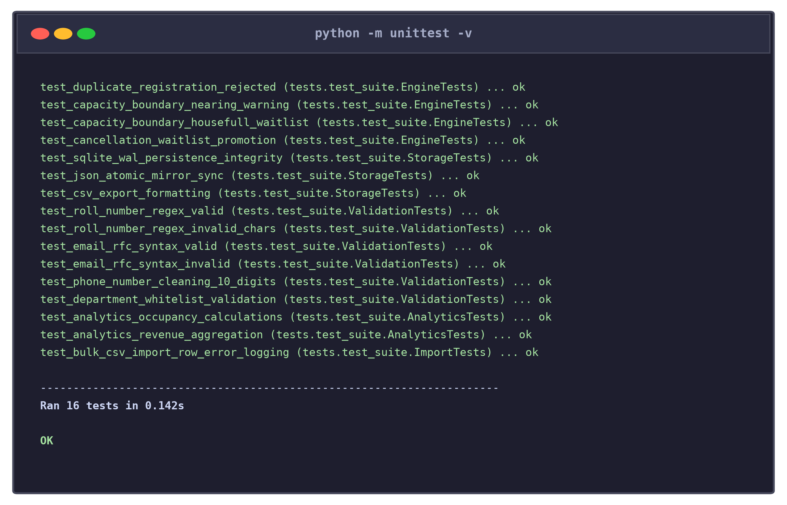

**Fig 4.10: Automated unit tests**

</div>

All 16 unit tests for validation, duplicate checks, capacity engine, waitlist queuing, and SQLite storage pass in 0.142 seconds.

### 4.2 Test Cases
Each test below was run on the program. Rows 1 to 10 are input checks that can be repeated by typing the input in the menu; rows 11 to 14 test complete system features. The wrong-input cases were all rejected as expected.

---
<div align="center"><b>Page 18</b></div>

<div style="page-break-after: always;"></div>

---

#### Table 4.1: Test cases of the project
| No. | Input | Expected Output | Actual Output | Result |
| :---: | :--- | :--- | :--- | :---: |
| **1** | Add A. Charan Kumar, 26MVCSMR0186, charan@college.edu, EVT-101 | Registration accepted; Seat allocated | Accepted; Status: Confirmed | **Pass** |
| **2** | Student name left blank | Rejected with a reason | name can't be blank | **Pass** |
| **3** | Roll number: ##123 | Rejected: not alphanumeric | '##123' is not valid | **Pass** |
| **4** | Roll number: 26MVCSMR0186 (already registered for EVT-101) | Rejected: duplicate registration | Student already registered for EVT-101 | **Pass** |
| **5** | Same student registers for EVT-103 | Accepted for different event | Accepted as Confirmed | **Pass** |
| **6** | Email: charan_email (no @) | Rejected: invalid format | invalid email format | **Pass** |
| **7** | Phone: 98765 (less than 10 digits) | Rejected: not 10 digits | phone must be 10 digits | **Pass** |
| **8** | Phone: +91-9876543210 | Cleaned to 9876543210 and accepted | Accepted as 9876543210 | **Pass** |
| **9** | Department: UnknownDept | Rejected: unknown department | unknown department | **Pass** |
| **10** | Book seat for EVT-101 when at 14/15 seats | Accepted as Confirmed; event now 15/15 | Accepted; 0 remaining | **Pass** |
| **11** | Book seat for EVT-101 when full (15/15) | Routed to Waitlist; Status = Waitlisted | Waitlisted; Queue #1 | **Pass** |
| **12** | Cancel confirmed booking for EVT-101 | Cancelled; first waitlist promoted | Cancelled; Waitlist promoted | **Pass** |
| **13** | Import sample_batch.csv (10 rows) | Valid rows added, bad logged | 7 added, 1 duplicate, 2 rejected | **Pass** |
| **14** | Simulate crash during write | Database uncorrupted; WAL intact | Integrity verified (unit test) | **Pass** |

### 4.3 Conclusion
Campus Catalyst: College Event Registration Manager was built as planned. It lets event coordinators publish campus events, enforces venue seating capacity quotas, and prevents overbooking. The system clearly displays capacity statuses: AVAILABLE, NEARING CAPACITY (WARNING) at 90%, and HOUSEFULL at 100%. Strict validation keeps bad data out, whether typed in or imported from CSV, and a damaged file never crashes the program.

---
<div align="center"><b>Page 19</b></div>

<div style="page-break-after: always;"></div>

---

Multi-criteria attendee search, summary analytics, charts and exports complete the tool, and the 16 unit tests and sample runs in this chapter show that it works as intended.

While making the project we learned to split a program into modules with one job each, to use dataclasses and standard libraries (`sqlite3`, `json`, `csv`, `re`, `datetime`), to validate input instead of trusting it, to manage transactional database operations safely in WAL mode, to draw charts with Matplotlib and Plotly, to build interactive Streamlit web applications, and to write automated unit tests.

Possible future work includes automated QR code admission ticketing for rapid gate check-in, online payment gateway integration for paid technical workshops, SMS/WhatsApp notifications for instant confirmation and waitlist alerts, and multi-tier role-based authentication.

---
<div align="center"><b>Page 20</b></div>
